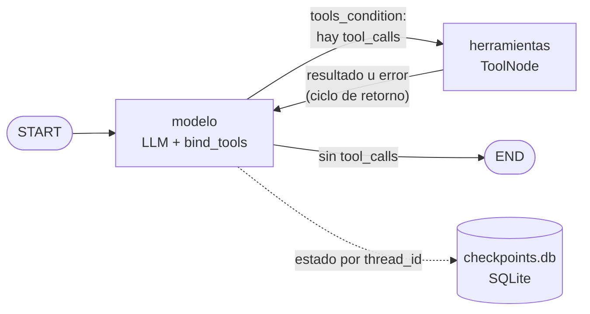

# Agente de razonamiento cíclico con memoria persistente (LangGraph)

Agente ReAct construido con **LangGraph** que decide por sí mismo cuándo llamar herramientas, reintenta o pide aclaraciones si una herramienta falla, y **recuerda la conversación** por `thread_id` gracias a un checkpointer **SQLite**. Todo el flujo es asíncrono (`asyncio`) y está tipado.

## Arquitectura



| Archivo | Contenido |
|---|---|
| `tools.py` | Herramientas `@tool` con docstrings descriptivos: `buscar_pedidos` y `detalle_pedido` (base de datos de pedidos simulada) |
| `agent.py` | `AgentState` (hereda de `MessagesState`), nodos, arista condicional `tools_condition`, `build_graph()` |
| `main.py` | Demo asíncrona, chat interactivo y generación de la traza |
| `traza_ejecucion.json` / `.log` | Traza ReAct de una ejecución real |

## Cómo levantar el entorno

Requiere **Python 3.12**.

```bash
py -3.12 -m venv venv
venv\Scripts\activate
pip install -r requirements.txt
```

Copiá `.env.example` a `.env` y poné tu clave (el `.env` está en `.gitignore`; nunca se sube):

```
OPENAI_API_KEY=sk-...
```

Ejecutar:

```bash
python main.py                          # demo completa; escribe traza_ejecucion.json y .log
python main.py --chat --thread-id ana   # chat interactivo; la sesión queda en checkpoints.db
```

Con `--chat`, si cerrás el programa y lo volvés a abrir con el **mismo `--thread-id`**, el agente sigue recordando la conversación, porque el estado vive en `checkpoints.db`.

## Cómo cumple cada criterio

- **Autonomía**: no hay `if/else` por tipo de pregunta. El LLM (con `llm.bind_tools()`) decide si responde o llama una herramienta; el grafo solo enruta con `tools_condition`.
- **Ciclo de retorno**: la arista `herramientas → modelo` devuelve el resultado al LLM. Si la herramienta devuelve un `error` (cliente inexistente, por ejemplo), el modelo lo lee y reintenta con otro argumento o le pide la aclaración al usuario.
- **Resiliencia de estado**: con el mismo `thread_id` el agente recuerda turnos anteriores ("¿y el anterior?"). Con otro `thread_id` empieza de cero.
- **Código limpio**: Python 3.12, type hints, `async`/`await` en el nodo del modelo, el streaming y el checkpointer.

### Decisiones de diseño

- **`AsyncSqliteSaver` en lugar de `SqliteSaver`**: es la variante asíncrona del mismo checkpointer SQLite (paquete `langgraph-checkpoint-sqlite`). `SqliteSaver` es síncrono y no soporta `astream`/`ainvoke`, así que en un entorno `asyncio` se usa esta clase.
- **`recursion_limit = 10`** en cada invocación (`RECURSION_LIMIT` en `agent.py`) para evitar bucles infinitos y costos inesperados. Una consulta de 2 herramientas usa unos 5 pasos. Si se alcanza el límite, `main.py` captura `GraphRecursionError` y lo informa sin romper.
- **Estado que no crece sin control**: el historial completo se guarda en el checkpoint, pero al modelo se le envían solo los últimos 20 mensajes (`trim_messages` dentro del nodo `modelo`).
- **Docstrings pensados para el LLM**: cada herramienta explica cuándo usarla, qué devuelve y qué NO hace (por ejemplo, `buscar_pedidos` no devuelve productos; para eso está `detalle_pedido`). Esa descripción es lo único que el modelo ve para decidir.
- **Errores como datos**: las herramientas devuelven un campo `"error"` con una pista, en lugar de lanzar excepciones. Así el modelo puede razonar sobre el fallo en el siguiente paso del ciclo.

## Escenario de la demo

`python main.py` ejecuta cuatro turnos:

1. **thread `demo-102`** — "¿Cuántos pedidos tuvo el cliente 102, cuál fue el total y qué productos incluía el último pedido?": requiere **dos herramientas en cadena** (`buscar_pedidos` para obtener el id del último pedido y luego `detalle_pedido`).
2. **thread `demo-102`** — "¿y el anterior a ese?": solo se entiende si recuerda el turno 1 (**memoria por `thread_id`**).
3. **thread `demo-999`** — cliente inexistente: la herramienta devuelve un error y el agente lo comunica o pide aclaración (**ciclo de retorno**).
4. **thread `demo-nuevo`** — "¿y el último?" sin contexto: el agente no tiene de qué hablar y pide aclaración (**aislamiento entre threads**).

## Traza de ejecución

_Pendiente: pegar acá el contenido de `traza_ejecucion.log` generado por `python main.py`._
